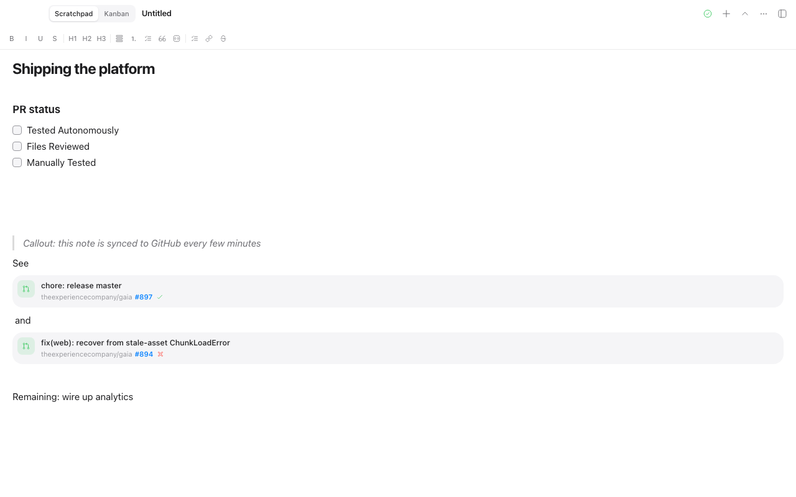
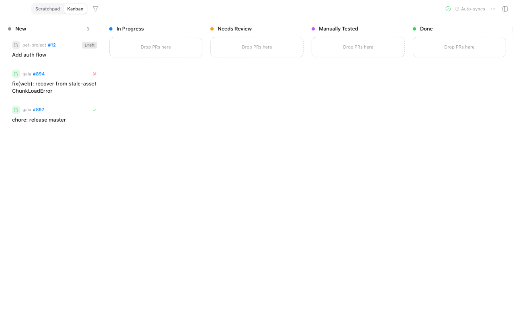

<p align="center">
  
</p>

<h1 align="center">Scratch</h1>

<p align="center">
  A minimal markdown scratchpad that lives in the corner of your screen — Notion-style editing, GitHub PR linking with <code>@</code>, and automatic sync to your own GitHub repo.
</p>

<p align="center">
  <a href="https://github.com/aryanranderiya/scratch/releases/latest"></a>
  
  
</p>

<p align="center">
  
</p>

## Why

Obsidian and Notion are heavy. macOS Stickies have no markdown and no sync. Scratch sits between them: a small, flat, Apple-clean window where thoughts, todos, and PR notes live as **plain markdown files** — stored locally, readable by anything, and synced to your own private GitHub repo every few minutes. Nothing is ever lost, and nothing is locked in.

## Features

- **Notion-like editor** — block markdown editing with `/` commands, headings, callouts, task lists, and a Notion-style PR reference card
- **`@` PR linking** — type `@` to search your open pull requests (your repos + org repos), sorted by readiness: passing CI, failing, idle, drafts at the bottom. Already-linked PRs show a blue icon + `Linked` chip
- **PR status checklist** — one click inserts the QA checklist (Tested Autonomously / Files Reviewed / Manually Tested)
- **PR triage board** — a kanban board (separate view) with custom columns, drag & drop, resizable columns, repo filtering, and GitHub-style PR/CI icons
- **Automatic sync** — notes are plain `.md` files in a local git vault, committed and pushed to your private GitHub repo every few minutes; pull-to-refresh in the PR picker
- **Apple-clean design** — SF Pro throughout, light & dark mode, flat surfaces, macOS segmented tabs, compact bottom-right window
- **iCloud optional** — the vault can live in iCloud Drive alongside GitHub sync

<p align="center">
  
</p>

## Download

**[Latest release →](https://github.com/aryanranderiya/scratch/releases/latest)**

| Platform | Artifact |
| --- | --- |
| macOS 11+ (Apple Silicon) | `Scratch_<version>_aarch64.dmg` |
| Linux | `scratch_<version>_amd64.AppImage` or `.deb` |
| Windows 10+ | `Scratch_<version>_x64-setup.exe` or `.msi` |

Every release ships the Apple Silicon DMG. Linux and Windows bundles are built by
[`.github/workflows/release.yml`](https://github.com/aryanranderiya/scratch/blob/main/.github/workflows/release.yml)
on each tag; until one shows up in a release, `pnpm tauri build` on that platform produces the same installers from source.
Intel Macs can build from source too — see [Build it yourself](#build-it-yourself).

### First launch on macOS

Builds are unsigned and not notarized yet, so Gatekeeper blocks the first open with
*"Apple could not verify 'Scratch' is free of malware"*. Allow it once with right-click → **Open**,
or clear the quarantine flag:

```bash
xattr -dr com.apple.quarantine /Applications/Scratch.app
```

### Build it yourself

```bash
pnpm install
OPENSSL_STATIC=1 pnpm tauri build   # → src-tauri/target/release/bundle/ (.app + .dmg on macOS)
```

`OPENSSL_STATIC=1` matters on macOS: without it the app links Homebrew's `libssl` and only launches on machines that
have the same Homebrew OpenSSL installed. It is safe to drop on Linux and Windows, where the system OpenSSL is
expected.

## Getting started

1. Install prerequisites: [Node 22](https://nodejs.org), [pnpm 10](https://pnpm.io), [Rust stable](https://rustup.rs)
2. `pnpm install`
3. `pnpm tauri dev`

On first launch, connect a GitHub Personal Access Token with `repo` scope. Scratch creates a private `scratch-notes` repository (or syncs to an existing one) and initializes your local vault (default `~/Scratch`, or iCloud Drive).

## Your notes are plain markdown

Every note is a `.md` file in your vault — syncable, grep-able, and readable by any editor:

```markdown
---
title: Untitled
created_at: 1786114051
updated_at: 1786114282
pinned: false
---

[@theexperiencecompany/gaia#901](https://github.com/theexperiencecompany/gaia/pull/901)

- [ ] hey there this is what i'm working on

[@theexperiencecompany/gaia#897](https://github.com/theexperiencecompany/gaia/pull/897)

- [ ] i gotta work on this task
```

The vault is a real git repository — even if Scratch never opened again, your notes, history, and remote are all intact.

## Development

```bash
pnpm dev                              # frontend (Vite)
pnpm tauri dev                        # desktop app
pnpm build                            # typecheck + build frontend
pnpm exec biome check src e2e         # lint
pnpm exec playwright test             # UI tests (headless)
cd src-tauri && cargo test            # backend command tests
pnpm tauri build                      # package .app + .dmg (add OPENSSL_STATIC=1 for a portable build)
```

## Architecture

- **Frontend**: React 19 + TypeScript + Vite + Tailwind v4 + TipTap (editor) + Zustand (state)
- **Backend**: Tauri v2 + Rust — `git2` for sync, `reqwest` for the GitHub API, commands in `src-tauri/src/commands.rs`
- **Notes**: one markdown file per note with YAML frontmatter (`title`, `created_at`, `updated_at`, `pinned`), stored in a local git vault
- **Sync**: the vault is a git repo on branch `main`; on a timer (default every 3 min) Scratch commits, fast-forwards from the remote, and pushes using your token
- **PR search**: GitHub search API (`is:open is:pr author:<login>` per org, in parallel), cached to disk for fast starts with background refresh
- **PR mentions**: a custom TipTap block node that serializes to `[@org/repo#123](https://github.com/org/repo/pull/123)` — plain markdown, fully portable

## Testing

- `src-tauri/tests/commands.rs` — integration tests exercising the real command handlers through Tauri's mock runtime, including git sync wiring (remote creation, `master` → `main` rename) and config migration
- `e2e/` — Playwright tests driving the built UI with a mocked Tauri IPC layer: editor, @ picker, kanban drag & drop, focus behavior, and layout-overflow audits at 320–900px

## Releasing

Releases are tag-driven:

```bash
git tag v0.1.0 && git push origin v0.1.0
```

CI builds macOS, Linux, and Windows bundles with `tauri-action` and attaches them to a draft release, which you
then edit and publish. Bump the version in `package.json` and `src-tauri/tauri.conf.json` before tagging.

To build the macOS disk image locally:

```bash
OPENSSL_STATIC=1 pnpm tauri build
```

`tauri build` asks Finder to lay out the DMG window, which stalls on headless or automation-denied machines. Then
build the app only and package it with `hdiutil`:

```bash
OPENSSL_STATIC=1 pnpm tauri build --bundles app
hdiutil create -volname Scratch \
  -srcfolder "src-tauri/target/release/bundle/macos/Scratch.app" \
  -ov -format UDZO Scratch_0.1.0_aarch64.dmg
```

Release artifacts are built per architecture — a universal arm64 + x86_64 app needs an x86_64 OpenSSL installed as
well, which stock Homebrew does not provide.

